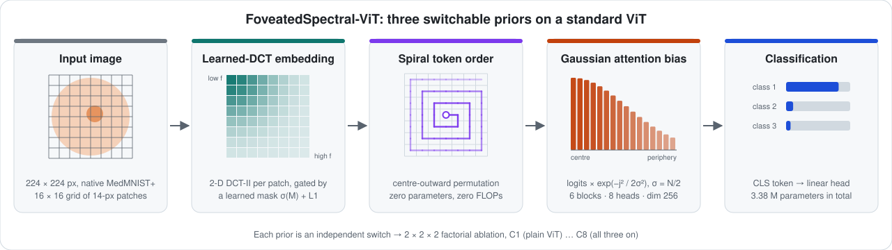
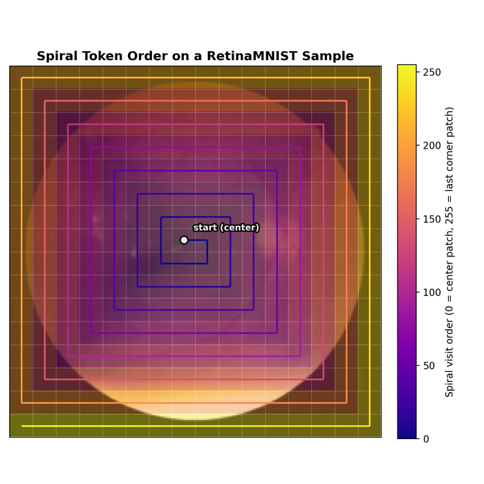
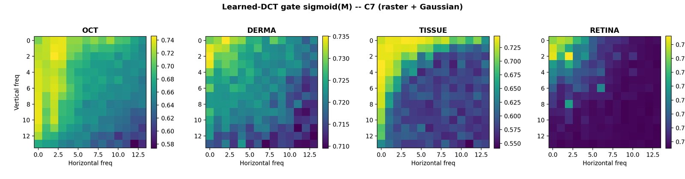
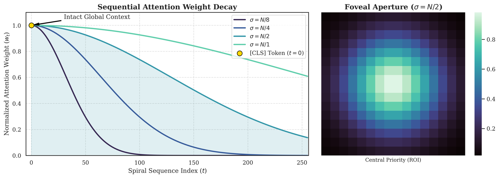
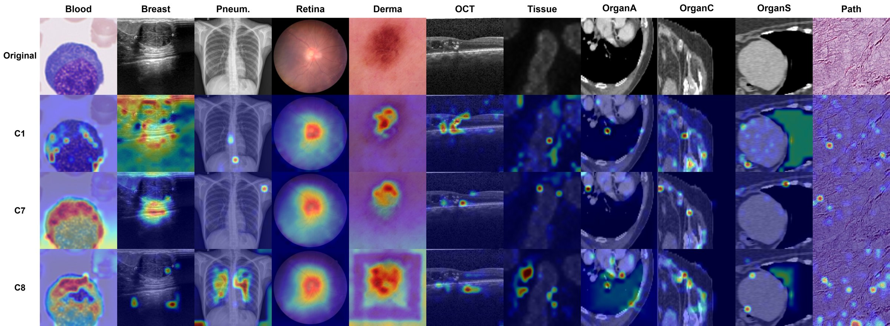

<div align="center">

# FoveatedSpectral-ViT

**A foveated, frequency-aware Vision Transformer for medical image classification**

*Spiral token ordering · learned-DCT patch embedding · Gaussian foveal attention bias*

[](LICENSE)
[](https://www.python.org/)
[](https://pytorch.org/)
[](https://medmnist.com/)
[](https://huggingface.co/lalodeavilaarm/spiral-vit-medmnist-ablation)

</div>

Code accompanying the manuscript submitted to *IEEE Access* (article citation to be added on publication).

Radiologists and dermatologists frame a study so that the finding sits near the centre of the image. FoveatedSpectral-ViT turns that habit into three lightweight priors on an otherwise standard Vision Transformer. Each prior can be switched on or off on its own, and all eight combinations (configs **C1–C8**) are trained from scratch and evaluated on all **12 MedMNIST v2 datasets at native 224 × 224 resolution**.

<p align="center">
  
</p>

## Highlights

| | |
|---|---|
| **Small** | 3.38 M parameters in every config, about 3.5× fewer than ResNet-18 and 7.6× fewer than ResNet-50. |
| **Nearly free priors** | Spiral ordering is a fixed index permutation, with no weights and no FLOPs. The learned-DCT gate adds 196 parameters. |
| **Strong where it fits** | Across 18 methods (8 configs plus 10 published baselines), our configs take the top 3 on **OCT** by accuracy and AUC, the top 3 on **Blood** by AUC, and first on **OrganC** by AUC. |
| **Honest ablation** | A full 2 × 2 × 2 factorial design with 95 % bootstrap CIs, McNemar tests and Cohen's κ. Each prior helps or hurts depending on whether the modality really centres its findings. |

## Method

<table>
<tr>
<td width="38%" valign="top">

### 1 · Spiral token order
Patches are fed to the transformer from the centre outward instead of row by row (`spiral_indices` in [`src/utils/token_order.py`](src/utils/token_order.py)). On its own this only changes each patch's *sequence position*. The Gaussian bias (3) turns that position into a spatial prior.

</td>
<td width="62%"></td>
</tr>
</table>

### 2 · Learned-DCT patch embedding
Each 14 × 14 patch goes through a 2-D DCT-II per channel. A learned sigmoid gate `σ(M)` then weights its frequency coefficients, with an L1 penalty that encourages sparsity, before the linear projection (`LearnedDCTEmbedding` in [`src/experiments/adaptive_dct/dct_variants.py`](src/experiments/adaptive_dct/dct_variants.py)). The gate learns a different frequency profile for each modality:

<p align="center"></p>

### 3 · Gaussian foveal attention bias
Attention logits are multiplied by a fixed decay over sequence position, `g[j] = exp(−j² / 2σ²)` with `σ = N/2` (`MultiHeadSelfAttention` in [`src/models/vit.py`](src/models/vit.py)). With spiral order, early positions are central patches, so the bias acts as a soft fovea. With raster order it favours the top-left corner instead, which serves as the control condition.

<p align="center"></p>

### The 2 × 2 × 2 ablation

| Config | Spiral order | Learned-DCT | Gaussian bias | |
|:--:|:--:|:--:|:--:|---|
| **C1** | | | | plain ViT baseline |
| C2 | ✓ | | | |
| C3 | | ✓ | | |
| C4 | | | ✓ | |
| C5 | ✓ | ✓ | | |
| C6 | ✓ | | ✓ | |
| C7 | | ✓ | ✓ | |
| **C8** | ✓ | ✓ | ✓ | full model |

Shared hyperparameters: `dim=256`, `depth=6`, `heads=8`, `mlp_dim=512`, dropout 0.1, 16 × 16 patch grid. Checkpoints are selected on the validation set; macro-F1 is reported next to accuracy and AUC because most of these datasets are class-imbalanced.

## Where the model looks

Grad-CAM for the baseline (C1), raster + DCT + Gaussian (C7) and the full model (C8) on one test image per dataset. The foveal priors pull attention onto the centred finding in dermoscopy, fundus and breast ultrasound. In CT and histology, where there is no canonical centre, they do not help. The ablation results show the same split.

<p align="center"></p>

The full per-dataset tables, significance tests and SOTA comparison are in the manuscript.

## Repository contents

| Path | Purpose |
|---|---|
| [`src/models/vit.py`](src/models/vit.py) | ViT with the three switchable axes (`embed_type`, `token_order`, `gaussian_bias`) |
| [`src/utils/token_order.py`](src/utils/token_order.py) | `spiral_indices` / `raster_indices` |
| [`src/experiments/adaptive_dct/dct_variants.py`](src/experiments/adaptive_dct/dct_variants.py) | Learned-DCT (and energy-based DCT) patch embeddings |
| [`src/data/medmnist_dataset.py`](src/data/medmnist_dataset.py) | MedMNIST v2 loaders at native 224 px |
| [`src/experiments/ablation_medmnist.py`](src/experiments/ablation_medmnist.py) | Trains all 8 configs for one dataset, with resume |
| [`src/experiments/download_medmnist_datasets.py`](src/experiments/download_medmnist_datasets.py) | Idempotent download of the 224 px releases |
| [`src/utils/training*.py`](src/utils/) | Training/eval loops; `training_multilabel.py` handles ChestMNIST (14 labels) |
| [`src/evals/medmnist_eval_utils.py`](src/evals/medmnist_eval_utils.py) | Checkpoint loading, bootstrap CIs, McNemar + Cohen's κ comparisons |
| [`src/evals/generate_*.py`](src/evals/) | Generators for the per-dataset and paper-benchmark notebooks |
| [`run_ablation.sh`](run_ablation.sh) | Download + train driver with automatic retries |

Trained weights for all 96 models (12 datasets × 8 configs) are on Hugging Face:
<https://huggingface.co/lalodeavilaarm/spiral-vit-medmnist-ablation>. Each checkpoint's `cfg` records its config (`config_id`, `embed_type`, `token_order`, `gaussian_bias`, `num_classes`, …). The transformer size is the same for all of them.

```python
import sys, torch
from huggingface_hub import hf_hub_download
sys.path.insert(0, "src")
from models.vit import ViT

path = hf_hub_download("lalodeavilaarm/spiral-vit-medmnist-ablation",
                       "derma/vit_derma_best_learned_dct_spiral_gaussian.pth")   # C8 on DermaMNIST
ckpt = torch.load(path, map_location="cpu", weights_only=False)
c = ckpt["cfg"]
model = ViT(image_size=c["image_size"], patch_size=c["patch_size"], num_classes=c["num_classes"],
            dim=256, depth=6, heads=8, mlp_dim=512, embed_type=c["embed_type"],
            token_order=c["token_order"], gaussian_bias=c["gaussian_bias"])
model.load_state_dict(ckpt["state_dict"]); model.eval()
```

The data and result files are not included in this repository.

## Installation

```bash
python -m venv .venv
source .venv/bin/activate          # Windows: .venv\Scripts\activate
pip install -r requirements.txt
```

You need a CUDA-capable GPU for training to finish in reasonable time.

A quick check that needs no data:

```bash
python -c "import sys; sys.path.insert(0, 'src'); import torch; from models.vit import ViT; m = ViT(image_size=224, patch_size=14, num_classes=9, dim=256, depth=6, heads=8, mlp_dim=512, embed_type='learned_dct', token_order='spiral', gaussian_bias=True); print(m(torch.randn(2, 3, 224, 224)).shape)"   # C8 → torch.Size([2, 9])
```

## Reproducing the experiments

### Training

```bash
# Default: organa, organc, organs, all 8 configs each, 100 epochs
./run_ablation.sh

# Any subset of the 12 datasets
./run_ablation.sh --datasets blood,breast,derma --epochs 100

# Data already downloaded
./run_ablation.sh --datasets organa --skip-download
```

Supported dataset keys: `blood`, `breast`, `pneumonia`, `retina`, `derma`, `path`, `chest`, `oct`, `tissue`, `organa`, `organc`, `organs`. `chest` is multi-label (14 independent findings) and is routed to [`training_multilabel.py`](src/utils/training_multilabel.py) automatically. Run `python src/experiments/ablation_medmnist.py --help` for the full CLI.

<details>
<summary><b>Resuming after an interruption</b></summary>

All three mechanisms are automatic and need no flags:

- **Within a config:** a per-epoch "latest" checkpoint resumes from the last completed epoch.
- **Across configs:** `checkpoints/medmnist/ablation_medmnist_state_<dataset>.json` records the finished configs, and a re-run skips them.
- **Whole run:** `run_ablation.sh` retries a dataset up to 10 times on a non-zero exit code (transient CUDA or driver errors), resuming through the two mechanisms above.

</details>

<details>
<summary><b>Output layout</b></summary>

```
data/MedMnist_fullres/       # downloaded MedMNIST npz files            (gitignored)
checkpoints/medmnist/        # best + latest checkpoints, state JSON     (gitignored)
results/ablation_medmnist/   # ablation_results_<dataset>_<ts>.csv,
                             # loss_curves_<dataset>_<ts>.csv            (gitignored)
```

Checkpoint names follow `vit_<dataset>_best_<embed_type>_<token_order>_<gauss_tag>.pth`.

</details>

### Evaluation

Two generators write the analysis notebooks, which keeps hand-edited `.ipynb` JSON out of version control. Run them from the repo root once checkpoints exist in `checkpoints/medmnist/`:

```bash
# Per-dataset EDA + test-set evaluation (one notebook per dataset)
python src/evals/generate_medmnist_notebooks.py

# Paper benchmark: 12 datasets × 8 configs, bootstrap CIs,
# McNemar + Cohen's κ, comparison with published baselines, Grad-CAM
python src/evals/generate_paper_benchmark_notebook.py
```

Both write unexecuted notebooks into `src/evals/`. Open them and run all cells. Intermediate results are cached under `results/MedMnist_fullres/benchmark_comparison/`, so an interrupted run picks up where it stopped.

<details>
<summary><b>Windows note</b></summary>

The bootstrap loop in `compare_models` calls native sklearn/numpy code thousands of times per dataset. On some Windows/CUDA driver combinations this has caused intermittent access violations. If it happens to you, replace `cohen_kappa_score` with a pure-numpy version and reseed the bootstrap RNG on each call.

</details>

## Data availability

All experiments use the public [MedMNIST v2](https://medmnist.com/) benchmark (224 × 224 release), which `run_ablation.sh` downloads automatically. Use of each dataset is subject to the MedMNIST licence terms and those of its original source.

## Citation

The article citation will be added on publication. Until then, please cite the repository:

```bibtex
@misc{foveatedspectralvit,
  title        = {{FoveatedSpectral-ViT}: code for the MedMNIST full-resolution ablation study},
  author       = {{Tamez Research Group}},
  howpublished = {\url{https://github.com/Tamez-Research-Group/FoveatedSpectral-ViT}},
  note         = {Manuscript submitted to IEEE Access}
}
```

## License

MIT, see [LICENSE](LICENSE).
